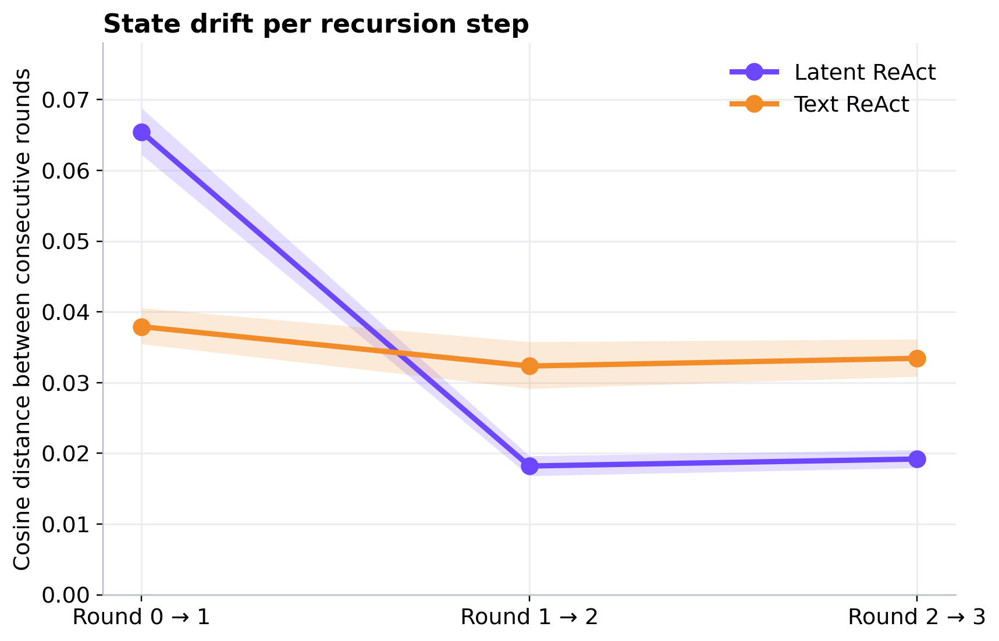
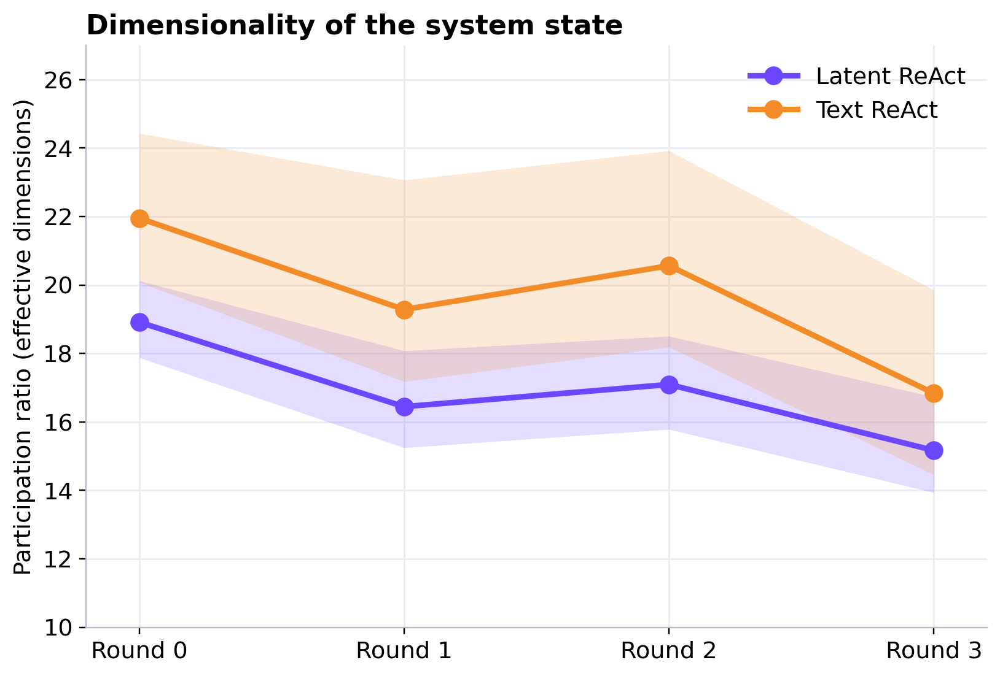
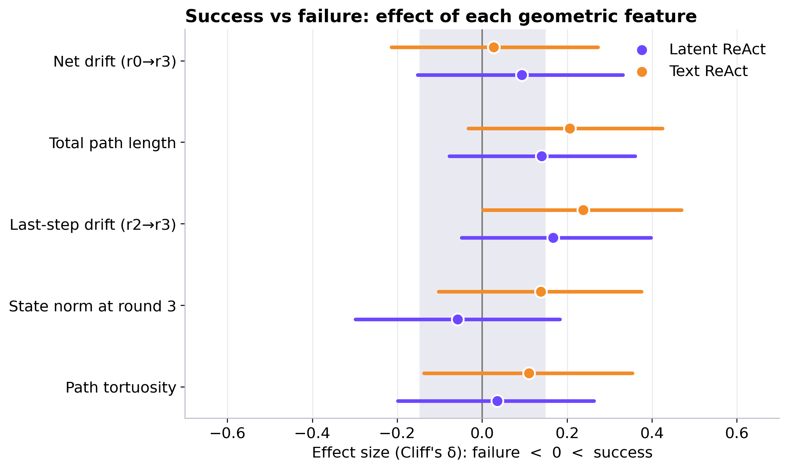

# Geometric analysis of RecursiveMAS latent states: findings

**Data:** 114 tau2-Bench Retail tasks x 2 architectures (Latent ReAct, Text ReAct), recursion depth 3 (rounds 0-3),
Qwen3.5-4B backbone (d = 2560, confirmed against the model's `config.json`).
**Object analysed:** the *system state* `Hr`, which is exactly `(H1 + H2 + H3) / 3` (the mean of the Planner,
Tool-Caller and Verifier vectors). Every statement below is about that mean, not about an individual agent.

Reproduce: `python final_figures.py` (writes `outputs/final/` and `results_final.json`).

---

## Finding 1: Latent recursion settles after one round; text recursion never does

| | round 0→1 | round 1→2 | round 2→3 | share of total movement in first step |
|---|---|---|---|---|
| Latent ReAct | 0.065 | 0.018 | 0.019 | **64 %** |
| Text ReAct | 0.038 | 0.032 | 0.033 | 37 % |

*(mean cosine distance between consecutive rounds; 95 % bootstrap CI over tasks is the shaded band)*

**What it shows.** In Latent ReAct the system state moves a lot once (round 0→1) and then barely moves
(0.018-0.019 per step). In Text ReAct it keeps moving by about the same amount every round.
The latent step 1→2 vs 0→1 contraction is highly significant (Wilcoxon p = 2e-20), and latent vs text differ at every
step (paired Wilcoxon p < 1e-10).

**Robustness check.** 66 of 114 tasks contain at least one agent state that is bit-identical to the previous round
(an agent whose state was not updated). Dropping all of them (48 tasks kept):

| | 0→1 | 1→2 | 2→3 | contraction p |
|---|---|---|---|---|
| Latent | 0.069 | 0.021 | 0.021 | 7e-15 (holds) |
| Text | 0.040 | 0.042 | 0.040 | 0.96 (**flat, no contraction**) |

So the latent result is not a duplicate-state artifact, and the small "contraction" in text seen on all 114 tasks
(p = 0.004) was produced by those duplicated states. Cleaned, text recursion is flat.

**Why (hypothesis, not yet proven).** The latent loop feeds each agent's own state back through a *residual*
adapter (`R(h) = h + W2 σ(W1 h)`), which tends to act like a contraction toward a fixed point: after the first
update the state is already close to where it will stay. In text mode every round re-encodes freshly generated
tokens, so the state keeps being perturbed by new wording, giving steady, noise-like movement.
**To confirm it** we need pre-/post-adapter vectors and a control with the adapter frozen or replaced (see
`docs/LOGGING_SPEC_AND_HARNESS_PROMPT.md`).

**Caveat.** The large first latent step could partly reflect how round-0 vectors are built (we do not know the
extraction details; see open issues below).

**Confidence:** high that the pattern exists in this data; medium on the mechanism.

---

## Finding 2: The latent system state is lower-dimensional than the text one

Participation ratio (effective number of dimensions used across the 114 tasks), mean over 200 random 90-task subsets:

| | round 0 | round 1 | round 2 | round 3 | change 0→3 |
|---|---|---|---|---|---|
| Latent ReAct | 18.9 | 16.4 | 17.1 | 15.2 | **-20 %** |
| Text ReAct | 22.0 | 19.3 | 20.6 | 16.8 | **-23 %** |

**What it shows.**
1. Latent states occupy fewer effective dimensions than text states: lower in 100 %, 97.5 %, 99.5 % and 81.5 % of subsets
   at rounds 0-3. The gap is clear for rounds 0-2 and weakens at round 3.
2. Both architectures *compress* with recursion by a similar amount (about 20-23 %, lower in 100 % of subsets).
   Compression is therefore a property of iterating the loop, not something unique to latent communication.

**Caveat.** Band = variability across random subsets (a spread, not a formal CI). Part of the latent-vs-text gap may
come from the two architectures using differently configured agents/adapters, so we describe it as a *difference*, not
as a benefit of latent communication.

**Confidence:** medium-high for the difference and the compression; low for any causal reading.

---

## Finding 3 (negative): Simple geometric features do not separate successful from failed rollouts

Effect size (Cliff's delta, 95 % bootstrap CI) of five geometric features, successes vs failures
(Latent: 33 successes / 81 failures; Text: 30 / 84).

**What it shows.** All point estimates are small (|delta| <= 0.24) and 9 of 10 intervals include 0. The one interval that
just excludes 0 (Text, last-step drift: delta = 0.24, CI 0.002-0.47) has raw p = 0.054 and Holm-adjusted p = 0.54.
After correcting for 10 tests nothing is significant (smallest adjusted p = 0.54).
Task difficulty tier also does not change drift (Kruskal-Wallis p = 0.73 Latent, 0.92 Text) and a linear probe
reads difficulty out at chance (balanced accuracy 0.29-0.38 vs 0.33 chance).

**How to read it.** This is an honest "no detectable link", not "no link": with 30-33 successes per architecture we
could only detect fairly large effects, and the analysed vector is a mean over three agents that may hide the one
agent that matters. The only (weak, uncorrected) lead is that the Tool-Caller's final state predicts success
slightly (AUC 0.62-0.64 in both architectures, permutation p = 0.05); it is worth re-testing with proper per-agent data.

**Confidence:** high that the *tested* summary features carry no large effect; no claim either way about subtler signals.

---

## What we can claim in the report

1. Latent recursion converges after the first round; text recursion keeps drifting at a constant rate (Finding 1).
2. Latent states are lower-dimensional than text states, and recursion compresses both (Finding 2).
3. Global drift/rank statistics do **not** explain which rollouts succeed or how hard the task is (Finding 3).
4. Performance still improves with depth (strict success 4 % -> 29 % Latent, 4 % -> 26 % Text from r = 0 to 3), so the benefit of
   recursion is not visible as a large late-round change in the system state. (Depths are separate runs, so this is suggestive only.)

## Known data issues that limit the claims

- `Hr` is derived (mean of three agents); per-agent, per-step vectors were not logged.
- 66 / 114 tasks have at least one non-updated (bit-identical) agent state between rounds.
- Latent `H1`/`H2` have about twice the norm of every other vector (46/43 vs 22); extraction point (pooling, layer, pre/post adapter) is undocumented.
- No tool-call log or `Accuracy` rubric, so "tool failure" cannot be analysed directly.
- Depth-d runs are separate rollouts (round-0 `Hr` differs between depth 0 and depth 3).
