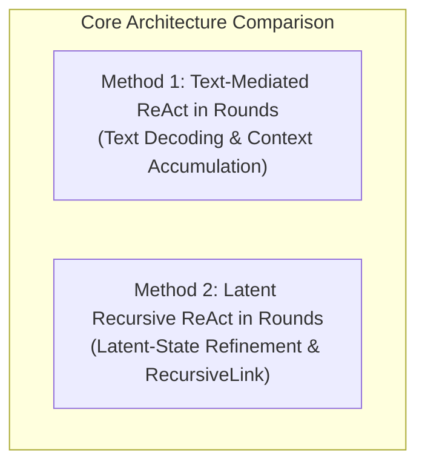
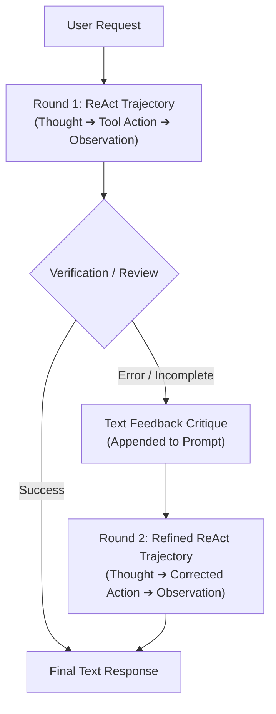
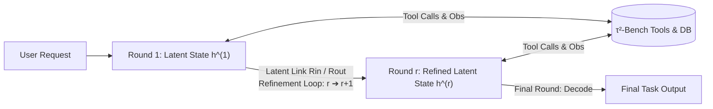
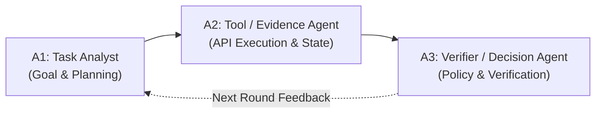
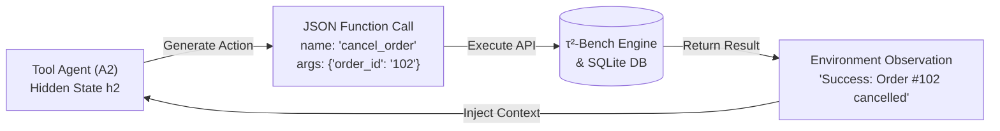
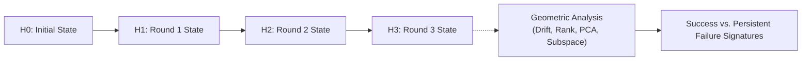

# Geometric and Performance Analysis of Recursive Multi-Agent Systems for Enterprise Process Automation

---

## 1. Dataset & Benchmark Environment

### 1.1 Overview: $\tau$-Bench / $\tau^2$-Bench Ecosystem
The project utilizes the **$\tau$-Bench / $\tau^2$-Bench** benchmark ecosystem as its primary experimental testbed. Unlike traditional static question-answering datasets, $\tau$-Bench is an **executable, interactive tool-agent-user simulation environment** modeled after real-world enterprise operations.

It contains:
* **Relational Database (SQLite Backend):** Real stateful database tables representing enterprise entities (e.g., users, product inventory, active and historical orders, tracking information, payment records).
* **Enterprise Business Policies ($p$):** Explicit deterministic operational rules and constraints (e.g., 30-day return windows, order cancellation eligibility before shipment, address modification constraints, refund policies).
* **Executable API Tools ($\mathcal{A}$):** Python-based tools that execute directly against the database to query information or perform state-altering transactions.
* **Interactive User Simulator ($u$):** Multi-turn conversational user agent that drives realistic, goal-oriented dialogues and dynamically reacts to agent responses.
* **State-Based Evaluation Oracle ($G$):** Automated verification functions that inspect the final environment/database state ($s_{\text{final}}$) and policy adherence to compute objective task success.

---

### 1.2 Selected Enterprise Domain
* **Primary Domain: Retail**
  * **Focus:** E-commerce customer service and order fulfillment workflows.
  * **Key Workflows:** Order status lookups, delivery tracking, customer address updates, item quantity modifications, order cancellations, return/exchange processing, and policy-compliant refund calculation.
  * **Rationale:** Provides a compact yet rich stateful environment where multi-step planning, tool interaction, and state-change dependencies are critical.
* **Secondary Domains (Optional / Robustness Extensions):**
  * **Airline:** Flight search, rebooking, itinerary modifications, baggage inquiries, cancellation fees.
  * **Telecom:** Account plan management, data add-on provisioning, service suspension, billing.

---

### 1.3 Task Formulation
A benchmark task is formalized as a 5-tuple:
$$T = (u, p, s_0, \mathcal{A}, G)$$

Where:
* $u$ = User request / conversational goal
* $p$ = Applicable enterprise domain policy
* $s_0$ = Initial database and environment state
* $\mathcal{A}$ = Available executable tools and API functions
* $G$ = Programmatic task goal and verification criteria

A complete task trajectory proceeds as:
$$T \longrightarrow a_1 \longrightarrow o_1 \longrightarrow a_2 \longrightarrow o_2 \longrightarrow \dots \longrightarrow y$$
where $a_i$ represents agent actions (tool calls or messages), $o_i$ represents environment observations, and $y$ is the final response.

---

### 1.4 Task Complexity Stratification
Task complexity is treated as an independent experimental variable ($\text{Task Complexity} \neq \text{Recursion Depth}$). Complexity is quantified using a multi-factor composite metric:

$$C = w_1 C_{\text{tool}} + w_2 C_{\text{turn}} + w_3 C_{\text{div}} + w_4 C_{\text{state}} + w_5 C_{\text{dep}}$$

Where:
* **Tool-call count ($C_{\text{tool}}$):** Total number of API invocations required.
* **Interaction depth ($C_{\text{turn}}$):** Number of conversational dialogue turns between user, agent, and environment.
* **Tool diversity ($C_{\text{div}}$):** Number of distinct tools required across the workflow.
* **State-change count ($C_{\text{state}}$):** Number of database mutation transactions (e.g., updates, cancellations, refunds).
* **Dependency depth ($C_{\text{dep}}$):** Length of the longest causal chain where an action requires outputs from previous tool observations.

#### Complexity Tiers & Concrete Workflow Definitions:

| Complexity Tier | Quantitative Thresholds | Operational Characteristics | Concrete Enterprise Example (Retail Domain) |
| :--- | :--- | :--- | :--- |
| **Easy (Low Complexity)** | 1–2 Tool calls<br/>0 State changes<br/>0 Dependency depth | Read-only information retrieval; single-step query resolution; no policy conflicts. | Retrieve tracking status and delivery estimate for Order `#1024` using customer email. |
| **Medium Complexity** | 3–4 Tool calls<br/>1 State change<br/>Linear dependency | Sequential tool interactions; single database state modification; basic identity and status verification. | Update shipping address for a pending order after verifying customer account details and shipment fulfillment status. |
| **Hard (High Complexity)** | 5+ Tool calls<br/>$\ge 2$ State changes<br/>Deep dependency chain | Deep dependency chains; multi-table database transactions; complex constraint validation (e.g., return windows, price difference calculations). | Process a multi-item return with replacement item stock checks, return window validation, and refund calculation after deducting restocking fees. |

---

### 1.5 Task Subsets & Splits
* **Train / Development Split:** Used for prompt tuning, complexity threshold calibration, and hyperparameter freezing.
* **Held-Out Test Split:** Strictly unseen tasks for matched-task architectural comparisons.
* **Recovery Subset:** A dedicated evaluation subset featuring tasks where an initial attempt fails or encounters errors, but the environment remains in a recoverable state, specifically designed to evaluate recursive self-correction and recovery rates.

---

## 2. Methodology & Architectural Framework

Alongside standard single-pass baselines (**Direct Agent** and **Single-Pass ReAct** at recursion depth $r=0$), the core experimental investigation focuses on comparing **two primary methods of multi-round recursive reasoning and execution** ($r \in \{1, 2, 3\}$):

1. **Text-Mediated ReAct in Rounds** (Iterative natural-language review and trajectory re-prompting)
2. **Latent Recursive ReAct in Rounds** (Latent-state refinement and cross-round transfer via RecursiveLink)



---

### 2.1 Method 1: Text-Mediated ReAct in Rounds (Text ReAct)

In this baseline method, multi-round recursion occurs entirely through **natural language decoding and prompt context accumulation**.

* **Round Execution ($r$):** The agent runs a standard ReAct trajectory ($\text{Thought} \rightarrow \text{Action} \rightarrow \text{Observation}$) until it proposes an outcome.
* **Inter-Round Review:** If the task is unresolved or incorrect, an explicit natural-language critique/review summarizes errors, missing information, or invalid tool arguments.
* **Re-Prompting:** The critique is appended as text into the prompt context for Round $r+1$, which initiates a fresh ReAct trajectory.
* **Communication Medium:** Full token generation and vocabulary projection $\Theta(m |V| d_h)$ at every round.

#### Architectural Diagram: Method 1 (Text ReAct in Rounds)



---

### 2.2 Method 2: Latent Recursive ReAct in Rounds (Latent RecursiveMAS)

In this method, multi-round refinement occurs **directly within the latent representation (hidden-state) space**, avoiding intermediate natural language decoding.

* **Latent Round Execution:** Rather than generating text thoughts between rounds, the agent refines its internal hidden state representation ($h^{(r)} \in \mathbb{R}^{d_h}$) across recursion rounds $r = 1, 2, \dots, R$ (instantiated across the specialized agent roles detailed in Section 3).
* **RecursiveLink Modules:**
  * **Inner RecursiveLink ($R_{\text{in}}$):** Residual transformation $R_{\text{in}}(h) = h + W_2 \sigma(W_1 h)$ for within-round latent state refinement.
  * **Outer RecursiveLink ($R_{\text{out}}$):** Representation mapping $R_{\text{out}}(h) = W_3 h + W_2 \sigma(W_1 h)$ transferring and projecting latent states across recursive passes and agent boundaries.
* **Tool Boundary vs. Latent Loop:**
  * **Tool Calls:** Explicitly decoded into structured function calls only when invoking $\tau^2$-Bench environment tools and receiving observations.
  * **Inter-Round Communication:** Exclusively latent ($\Theta(m d_h^2)$ lightweight projections), eliminating intermediate vocabulary decoding.
* **Final Decoding:** Natural language response is decoded only at the final convergence round ($r = R$).

#### Architectural Diagram: Method 2 (Latent Recursive ReAct in Rounds)



---


## 3. Agentic Framework

### 3.1 Model Backbone & Foundation Setup
* **Base Model:** A unified **Qwen** backbone (e.g., Qwen2.5-7B-Instruct) across all agent roles.
* **Frozen Weights:** Base LLM weights remain frozen across experiments to eliminate parameter confounding and ensure fixed hidden-state dimensions ($d_h$).
* **Role Specialization:** Behavioral differentiation is achieved through tailored role prompts, tool access permissions, and lightweight `RecursiveLink` adaptation.

---

### 3.2 Specialized Agent Roles
The multi-agent framework distributes enterprise responsibilities across three dedicated roles:



1. **Agent 1 ($A_1$) — Task Analyst / Planner:**
   * **Role:** Deconstructs customer requests, analyzes initial context, identifies missing information, and formulates step-by-step action plans.
   * **Tool Access:** None (operates purely on conceptual planning and latent representation transfer).

2. **Agent 2 ($A_2$) — Tool / Evidence Agent:**
   * **Role:** The primary executable agent. Selects appropriate enterprise tools, constructs structured JSON arguments, executes API calls against the $\tau^2$-Bench environment, and processes returned observations.
   * **Tool Access:** Full access to domain-specific executable APIs (database lookups, order modifications, transactional actions).

3. **Agent 3 ($A_3$) — Verification / Decision Agent:**
   * **Role:** Evaluates whether actions taken and evidence collected satisfy the user goal and conform to enterprise business policies ($p$). Detects inconsistencies, verifies database state mutations, and either approves final task completion or triggers another recursive round.
   * **Tool Access:** Read-only / verification tools if required by the domain.

---

### 3.3 Prompt Structure & Context Composition
Prompts are modularly constructed to ensure clear role behavior, precise tool interaction, and efficient compute utilization. The prompt for each agent combines **Static Invariant Context** with **Dynamic Conversational State**:

```text
┌────────────────────────────────────────────────────────┐
│ 1. Global System Instruction                           │ ──┐
│ 2. Role-Specific Directive (Analyst / Tool / Verifier) │   │ Static Context
│ 3. Executable Tool Schemas (JSON Function Definitions) │   │ (KV-Cached)
│ 4. Enterprise Domain Policies (Business Rules p)       │ ──┘
├────────────────────────────────────────────────────────┤
│ 5. User Request & Dialogue History (T = u, s0)         │ ──┐
│ 6. Tool Execution History & Live Observations (o_i)    │   │ Dynamic Context
│ 7. Multi-Round Feedback / Injected Latent State (h)    │ ──┘ (Per Turn / Round)
└────────────────────────────────────────────────────────┘
```

#### Detailed Breakdown of Prompt Layers:
1. **Global System Instruction:** Establishes the agent’s core operational protocols, reasoning standards, and output formatting rules.
2. **Role-Specific Directives:** Specifies the exact obligations of each agent (e.g., $A_1$ focuses on task decomposition; $A_2$ strictly constructs and triggers tool calls; $A_3$ verifies policy compliance and decides completion).
3. **Executable Tool Schemas:** Standardized JSON schemas declaring tool names, descriptions, input argument types, and required parameters (provided only to tool-enabled agents).
4. **Domain Policies ($p$):** Explicit business constraints governing valid actions (e.g., return window limits, address modification conditions).
5. **Dynamic History & Observations:** Multi-turn dialogue history, intermediate thoughts, and raw API observation responses returned by the $\tau^2$-Bench environment.
6. **Static Prefix Caching (Optimization):** Invariant components (System + Role + Tool Schemas + Policies) are held in fixed prefix positions. When running multiple turns and recursive rounds, the LLM runtime caches their Key-Value (KV) states, eliminating redundant recomputation.

---

### 3.4 Tool-Calling Mechanism & Execution Interface
Tool calling acts as the **explicit, machine-readable bridge** between the agent's internal reasoning and the external $\tau^2$-Bench enterprise environment.



#### 1. Invocation Format & Schema Standards
* Tool calls are generated in structured JSON format adhering to OpenAI/Qwen function-calling standards:
  ```json
  {
    "tool_name": "modify_order_address",
    "parameters": {
      "order_id": "ORD-94821",
      "new_street": "123 Innovation Way",
      "new_city": "Seattle",
      "new_zip": "98101"
    }
  }
  ```
* Tool invocations are parsed deterministically. If an argument is missing or malformed, the runtime intercepts the error and returns a structured validation failure observation to prompt self-correction.

#### 2. Tool Execution Lifecycle
1. **Tool Decision & Selection:** Agent 2 inspects the task state and selects the appropriate API tool from the schema.
2. **Argument Construction:** Generates strictly-typed parameter values based on the dialogue context.
3. **Environment Execution:** The $\tau^2$-Bench execution engine intercepts the tool call, applies the corresponding Python database query or transaction to the mock SQLite backend, and verifies policy constraints.
4. **Observation Feedback:** The result (e.g., customer records, order confirmation, error messages) is formatted as an observation string ($o_i$) and fed back into the agent's context.

---

### 3.5 Latent Communication vs. Explicit Tool Boundary
A key design principle is the separation between internal agent collaboration and external environment interaction:
* **Internal Agent-to-Agent Reasoning:** Kept **latent** ($A_1 \xrightarrow{R_{\text{out}}} A_2 \xrightarrow{R_{\text{out}}} A_3$). Agents communicate high-dimensional representation vectors ($h \in \mathbb{R}^{d_h}$) using lightweight `RecursiveLink` transformations, avoiding text decoding overhead ($\Theta(m d_h^2)$ vs. $\Theta(m |V| d_h)$).
* **External Environment Interaction:** Kept **explicit**. Only Agent 2 projects its hidden state into text/JSON tokens to execute external API calls against $\tau^2$-Bench.

---

## 4. Research Questions & Hypotheses

### 4.1 Core Research Questions (RQs)

* **RQ1 (ReAct Baseline Effectiveness):** Does explicit Thought–Action–Observation interleaving (ReAct) improve enterprise task success and policy compliance compared to a direct, single-pass tool-using agent?
* **RQ2 (Recursive Error Recovery):** Does multi-round recursive refinement enable agents to recover from initially failed, incomplete, or erroneous tool interactions compared to standard single-pass ReAct?
* **RQ3 (Recursion Depth vs. Tradeoffs):** How does scaling recursion depth ($r \in \{0, 1, 2, 3\}$) affect task success, tool-selection accuracy, token consumption, latency, and computational cost?
* **RQ4 (Complexity Interaction):** Does the performance benefit of multi-round recursive reasoning increase systematically as task complexity (tool count, turn depth, state dependencies) increases?
* **RQ5 (Geometric Signatures of Reliability):** Do hidden-state geometric properties (representation drift, cosine similarity, effective rank, subspace angles) distinguish successful error recovery from persistent execution failure?
* **RQ6 (Latent Communication Efficiency):** Can latent recursive multi-agent communication achieve comparable or superior task accuracy to text-mediated recursion while significantly reducing intermediate token generation and decoding latency?

---

### 4.2 Research Hypotheses (H1 – H6)

* **H1 (ReAct Superiority):** ReAct will achieve significantly higher task success than direct single-pass agents on multi-step enterprise tasks due to intermediate state grounding and observation inspection.
* **H2 (Recursive Refinement & Recovery):** Multi-round recursive ReAct will yield higher final task success and recovery rates on recoverable failures compared to single-pass ReAct.
* **H3 (Complexity Dependence):** The relative performance gain from recursion will be disproportionately larger on High-Complexity tasks than on Low-Complexity tasks.
* **H4 (Diminishing Marginal Returns):** Increasing recursion depth ($r=1 \rightarrow 2 \rightarrow 3$) will exhibit diminishing marginal gains in accuracy while incurring linear or super-linear increases in token usage and latency.
* **H5 (Geometric Separability):** Successful refinement trajectories will exhibit distinct geometric signatures—characterized by bounded representation drift, stabilized effective rank, and subspace alignment—contrasting with divergence or collapse in persistent failure trajectories.
* **H6 (Latent Computational Efficiency):** Latent recursive communication will reduce intermediate communication overhead from $\Theta(m \cdot |V| \cdot d_h)$ to $\Theta(m \cdot d_h^2)$, resulting in lower wall-clock latency and reduced token consumption compared to text-mediated multi-round recursion at matched depths.

---

### 4.3 Experimental Design & Controlled Factors

| Experimental Factor | Evaluated Levels / Values | Control Purpose |
| :--- | :--- | :--- |
| **Architectural Method** | Direct $\rightarrow$ ReAct $\rightarrow$ Text ReAct in Rounds $\rightarrow$ Latent RecursiveMAS | Isolate effects of reasoning, recursion, and communication medium |
| **Recursion Depth ($r$)** | $r \in \{0, 1, 2, 3\}$ | Measure marginal accuracy gains vs. latency/compute costs |
| **Task Complexity ($C$)** | Low, Medium, High | Evaluate how workflow difficulty interacts with recursive depth |
| **Task Condition** | Standard Test Split vs. Recoverable Failure Subset | Quantify standard accuracy vs. error-recovery capabilities |
| **Base Model Backbone** | Shared Frozen Qwen Backbone (e.g., Qwen2.5-7B-Instruct) | Eliminate base-model confounding; fix latent dimensionality |
| **Evaluation Testbed** | $\tau^2$-Bench Retail Environment (SQLite Backend) | Maintain standardized, reproducible environment and policy oracle |

---

## 5. Evaluation & Analysis Framework

The evaluation framework consists of two core analytical pillars: **Performance & Computational Comparison** and **Geometric Representation Analysis**.

---

### 5.1 Part 1: Performance & Computational Comparison

This part evaluates end-to-end task completion, tool interaction fidelity, and resource efficiency across architectures, recursion depths ($r=0,1,2,3$), and complexity levels.

#### A. Task Performance & Reliability Metrics
* **Task Success Rate ($\text{SR}$):** Binary proportion of tasks where the final database state satisfies all goal criteria:
  $$\text{Success}(T) = \begin{cases} 1 & \text{if all state \& goal criteria are satisfied} \\ 0 & \text{otherwise} \end{cases}$$
* **Error Recovery Rate ($\text{RR}$):** Percentage of initially failed executions in the Recovery Subset that achieve success in subsequent recursive rounds ($r > 1$).
* **Failure Mode Distribution:** Fine-grained categorization of failures (wrong tool, invalid arguments, policy constraint violation, premature termination, state-tracking loss).

#### B. Tool-Use Quality Metrics
* **Tool Selection Accuracy:** Percentage of steps where the agent selects the optimal tool from the schema.
* **Tool Argument Precision:** Percentage of required parameters populated with valid, policy-compliant data.
* **Valid Tool-Call Rate:** Ratio of executable tool calls to syntax/validation errors.
* **Redundant Call Rate:** Frequency of unnecessary, duplicate, or loop-generating tool invocations.

#### C. Computational & Resource Efficiency Metrics
* **Token Breakdown:** Separate tracking of reasoning tokens, tool-call tokens, intermediate inter-agent/inter-round tokens, and final response tokens.
* **Component-Wise Latency ($L_{\text{total}}$):**
  $$L_{\text{total}} = L_{\text{model}} + L_{\text{decode}} + L_{\text{tool}} + L_{\text{comm}}$$
* **Theoretical Communication Cost:**
  * Text-Mediated Recursion: $\Theta(m \cdot |V| \cdot d_h)$ (vocabulary decoding per intermediate turn).
  * Latent RecursiveMAS: $\Theta(m \cdot d_h^2)$ (`RecursiveLink` matrix transformations).
* **Empirical Compute Profiling:** Peak GPU VRAM utilization (GB), wall-clock inference time (s), and estimated FLOPs.
* **Accuracy–Cost Tradeoff Curves:** Pareto frontier plots comparing Task Success vs. Tokens, Latency, and Estimated FLOPs across recursion depths.

---

### 5.2 Part 2: Geometric Representation Analysis

This part analyzes the internal geometry and evolutionary trajectories of hidden representations ($H_r$) across recursive passes to uncover why recursion succeeds or fails.



#### A. Representation Extraction Protocol
* Hidden vectors ($H_{a,r} \in \mathbb{R}^{d_h}$) are extracted from the final Transformer layer prior to the action/vocabulary projection at fixed decision checkpoints across rounds $r \in \{0, 1, 2, 3\}$.

#### B. Geometric Metrics & Formulations

| Geometric Metric | Mathematical Formulation | What It Quantifies |
| :--- | :--- | :--- |
| **Cosine Similarity** | $\text{CosSim}(H_i, H_j) = \frac{H_i^\top H_j}{\|H_i\| \|H_j\|}$ | Directional alignment between agent states or recursive passes. |
| **Representation Drift ($D_r$)** | $D_r = 1 - \text{CosSim}(H_r, H_{r-1})$ | Magnitude of internal state modification and refinement between successive rounds. |
| **Inter-Agent Distance ($D_{ij}$)** | $D_{ij} = \|H_i - H_j\|_2$ | Representational separation / role specialization between agents ($A_1, A_2, A_3$). |
| **Effective Rank ($\text{ER}$)** | $\text{ER}(H) = \exp\left(-\sum_{k=1}^K p_k \ln p_k\right)$ where $p_k = \frac{\sigma_k}{\sum \sigma_i}$ | Effective intrinsic dimensionality and representational collapse/expansion. |
| **Principal Subspace Angles** | $\theta_1 = \arccos\left(\max_{u \in \mathcal{U}, v \in \mathcal{V}} \frac{u^\top v}{\|u\|\|v\|}\right)$ | Geometric alignment between task complexity subspaces or agent representational spaces. |
| **PCA / SVD Trajectories** | Low-dimensional orthogonal projection | Visual 2D/3D mapping of convergence paths vs. wandering/divergent paths. |

#### C. Success vs. Failure Trajectory Characterization
* **Successful Recovery Signatures ($H_0 \rightarrow H_1 \rightarrow \dots \rightarrow \text{Success}$):** Hypothesized to display monotonic convergence in drift ($D_r \rightarrow 0$), stable effective rank, and trajectory clustering toward a task-solution attractor.
* **Persistent Failure Signatures ($H_0 \rightarrow H_1 \rightarrow \dots \rightarrow \text{Failure}$):** Hypothesized to display chaotic oscillation, representational collapse ($\text{ER} \downarrow$), or divergent drift indicating inability to resolve errors.

